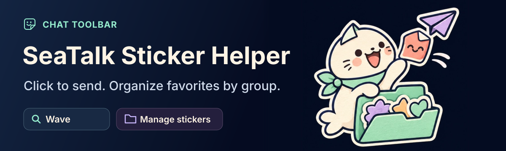

[简体中文](README.md) | **English**

# SeaTalk Sticker Helper · 5.2.2

> Find a favorite sticker by its notes, send it to the current chat or share a selection with a friend.

## Install or update

1. Install [Tampermonkey](https://www.tampermonkey.net/) and allow user scripts.
2. Install/update the [existing Greasy Fork script](https://greasyfork.org/en/scripts/588931), checking version **5.2.2**.
3. Disable other previews, reload [SeaTalk Web](https://seatalkweb.com/) and open SeaTalk Sticker Helper.

**Chrome / Edge permission path:** Right-click the Tampermonkey icon → Manage extension → enable **Allow User Scripts**. If this option is unavailable, enable **Developer mode** on the browser extension-management page. Return to SeaTalk and reload.

## What you can do

- **Find the right sticker** with searchable names, keywords, visible text and private notes.
- **Send with confirmation** from a single preview or a selection. Check the conversation, images and count before sending one at a time.
- **Share useful context**: codes can carry names, keywords and sticker text. Keep personal notes and merge keywords by default.
- **Take your settings with you**: export and restore personal notes and manual image-format labels. AI items needing review start unchecked; Select all is available.
- **Filter clearly**: image format, note status and inspection status are separate. Edit notes without inspection; manually label an animation or still image when needed.
- **Choose your workspace.** Use My stickers in a sidebar or a floating window. Switch between English and Chinese in Settings.

## My stickers

1. Open SeaTalk's sticker picker and its heart **Favorites** tab, then open **My stickers**. Sync continues after the picker closes; batch removal still needs the native Favorites picker mounted.
2. Edit a sticker's name, keywords, text, private note or image format. Saving confirms its notes and clears Needs review.
3. Search and filter. Selections survive paging; Review selected includes items outside the current filter.
4. Send from a preview or Send selected. Verify the destination and images, then confirm. Up to 100 stickers per operation; ordinary direct and group chats only, without threads.

Changing accounts or conversations stops later sends. Unconfirmed results stop without automatic retries. Check the chat and reload before continuing.

## Share and import

Select 1–100 stickers → Share code → copy and send it yourself. Recipients use Import code → Parse and preview → select → confirm adding. Existing favorites are not added again but can receive notes; new stickers need a successful preview.

Codes with notes use `STGIF2` and require 5.2 or compatible previews. Uncheck metadata for legacy `STGIF1`. Private notes and manual format labels are excluded. Codes contain readable resource IDs and optional metadata; availability is not guaranteed forever.

## Personal backup

Settings → Personal data → Export personal backup saves JSON. On another computer, choose a backup or labels file, preview, select and confirm. Existing notes are kept by default, with keyword merging; choose replacement per item when needed.

Backups include private notes: keep them safe. Notes are stored per account in Tampermonkey. Clearing extension storage or uninstalling may remove them. Restore changes only personal notes and format labels; it never adds, removes or sends stickers and does not back up image files.

## Remove favorites in batches

Select stickers → **Remove selected** → review the images and count → **Confirm removal**. Use Review selected to check items outside the current filter; those items are included in the removal list too.

This removes your favorites, not chat messages. The helper cannot undo removal, and sharing codes do not guarantee recovery. If a result is unconfirmed, reload SeaTalk and check before retrying. Stop waits for the current item before stopping later operations.

## Window and language

Choose **Settings → Language** to switch between English and Chinese. Your search, filters and selections are preserved. Use **Settings → Window layout** in My stickers for split view, floating mode or Reset layout. Wide screens use split view; drag the divider to resize. Floating windows can be moved and resized. Minimize keeps the current workspace state. Closing or minimizing restores SeaTalk's layout. Reloading clears selections and inspection progress but preserves saved notes.

While open, the helper reads the current account's local SeaTalk favorites state every 1.5 seconds; you can also choose **Sync favorites**. Sync continues when the native picker closes and pauses during operations and dialogs. It updates the helper list without fetching server data; uncertain results still require a SeaTalk reload to verify saved changes. Exports, sync and batch operations show explicit feedback. Check browser downloads to confirm a file was saved.

## Privacy and compatibility

Runs only on SeaTalk Web using SeaTalk's own image and business services. No independent tracking service or upload of chats, passwords or cookies to other services. Sending requires your confirmation and uses native SeaTalk actions; uncertain results stop without retries.

See the [5.2.2 release record](docs/release-notes-5.2.2.md) for the changes in this version. Unofficial tool, not affiliated with or endorsed by SeaTalk.

[GitHub Release · 5.2.2](https://github.com/Candle-Git/seatalk-personal-gif-avatar-helper/releases/tag/v5.2.2) · [Issues](https://github.com/Candle-Git/seatalk-personal-gif-avatar-helper/issues) · [中文](README.md)
