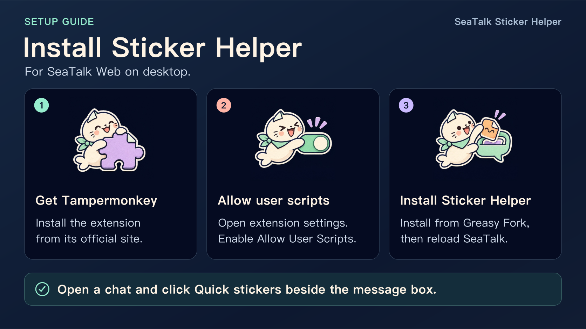
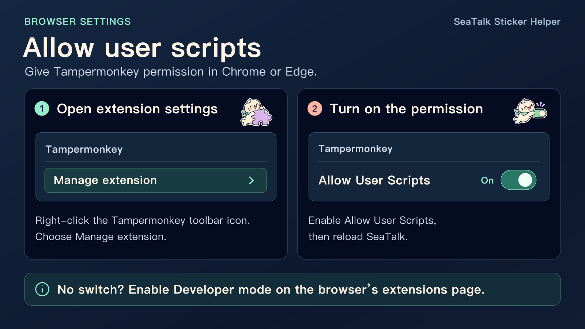

[简体中文](README.md) | **English**

# SeaTalk Sticker Helper · 5.3.0

Open **Quick stickers** beside the chat input, search your favorites and click a sticker to send it to the current conversation. Open **Manage stickers** in the same panel to organize a collection or review a batch before sending.

## Install or update

1. Install [Tampermonkey](https://www.tampermonkey.net/). In Chrome or Edge, right-click its extension icon, open **Manage extension** and enable **Allow User Scripts**. If that switch is unavailable, enable **Developer mode** on the extensions page.
2. Install or update to **5.3.0** from the [original Greasy Fork listing](https://greasyfork.org/en/scripts/588931). In English, the Tampermonkey dashboard lists it as **SeaTalk Sticker Helper · v5.3.0**. Updating in place keeps the settings saved for each account in this browser.
3. Reload [SeaTalk Web](https://seatalkweb.com/) and open a direct or group chat. Look for the folded-corner smiley in the chat toolbar. A **Quick stickers** hint appears beside it briefly. If the panel asks you to load favorites, open the heart-shaped **Favorites** tab in SeaTalk’s own sticker picker once, then reopen Quick stickers.

**Upgrading from 5.2?** If you still need to restore an old personal backup, import it in 5.2 before updating in place. After upgrading, create new codes for sharing and export a fresh backup before changing computers. Version 5.3 reads `STGIF3` codes and version 3 personal backups (`schema: 3`). It cannot import 5.2’s `STGIF1` or `STGIF2` codes or older personal backups. Sticker text and private notes already saved in this browser remain searchable here. Keep your original 5.2 backup if you need an archive of those fields. New backups and share codes omit them.

## Send and collect in a chat

- **Send one sticker.** Quick stickers shows the recipient at the top and searches across all favorites. Scroll for more or switch between newest and oldest first. One click sends immediately. A double-click sends once. After switching accounts or conversations, reopen the picker in the intended chat.
- **Collect from chat.** Choose **Collect from chat**, drag across messages and click **Review selection**. Select up to 100 stickers at a time. Plain text is skipped and repeated stickers count once. Review the new and already-saved counts, choose a group or add search keywords if needed, then confirm. You can organize stickers you already have in the same step.
- **Send a batch.** In **Manage stickers**, clicking a card selects it. Choose **Send**, check the recipient, images and count, then confirm. The helper sends up to 100 stickers one at a time in ordinary direct or group chats. If a send cannot be confirmed, it stops. Check the conversation before trying again.

## Organize your favorites

| Task | In Manage stickers |
| --- | --- |
| Search across groups | The manager opens to **Ungrouped** and searches the active group. Click **All**, pinned on the left, to search every group. The other group tabs scroll horizontally. |
| Select several stickers | Ctrl-click or ⌘-click to add or remove individual stickers. Shift-click selects a range. Drag from a gap in the grid to select an area, or hold Shift while dragging to add to the selection. **Review selected** includes stickers selected on other pages. |
| Rename or move stickers | Select one and choose **Edit sticker** to change its name, keywords or group, or create a group. With several selected, choose **Organize selection** to apply one name, move the stickers or append keywords. Blank fields keep their values. Keywords are deduplicated, and the preview counts the existing names you would replace. |
| Filter or sync | Open **Tools** to filter by image format, note status or inspection status. Active filters stay visible near the search box when Tools closes. Click a filter there to remove it. **Sync favorites** rereads the favorites loaded in the current page. |
| Remove favorites | Keep the heart-shaped Favorites tab open in SeaTalk’s own picker. Select stickers and choose **Remove selected**. Check the full list, including selections outside the current filter, before confirming. The helper cannot undo removal. |

The **Guide** in the manager’s title bar is always available. Open **Settings** to change the language or switch between split view and a floating window. Minimize with **−** and reopen **Quick stickers → Manage stickers** to resume your selection.

## Share and back up

**Share stickers with a friend.** Select 1–100 stickers in the manager, choose **Share code** and copy the full code. Names and search keywords are included by default. Clear that option before copying if you want to share just the stickers. In 5.3, the recipient opens **Tools → Import code**, pastes the code, previews the stickers and confirms which ones to add. Existing favorites are skipped. Their names are kept by default and keywords are merged without duplicates. The recipient can choose the shared name for individual stickers. The code is readable, so check the selection before sharing.

**Move to another computer or clear browser data.** Open **Settings → Personal data → Export personal backup**, then check that the JSON file is in your downloads. It contains names, search keywords, groups, manual image formats and review status. On the other computer, sign into the corresponding account, choose the backup file under Personal data, preview the entries and click **Import selected settings**. Existing settings are kept by default. Entries that need review start unchecked. The backup stores your settings. SeaTalk supplies the sticker images.

This community project runs on SeaTalk Web and uses SeaTalk’s own image and chat services. Personal settings are stored by account in Tampermonkey in the current browser.

[5.3.0 release notes](docs/release-notes-5.3.0.md) · [Report an issue](https://github.com/Candle-Git/seatalk-personal-gif-avatar-helper/issues) · [简体中文](README.md)
