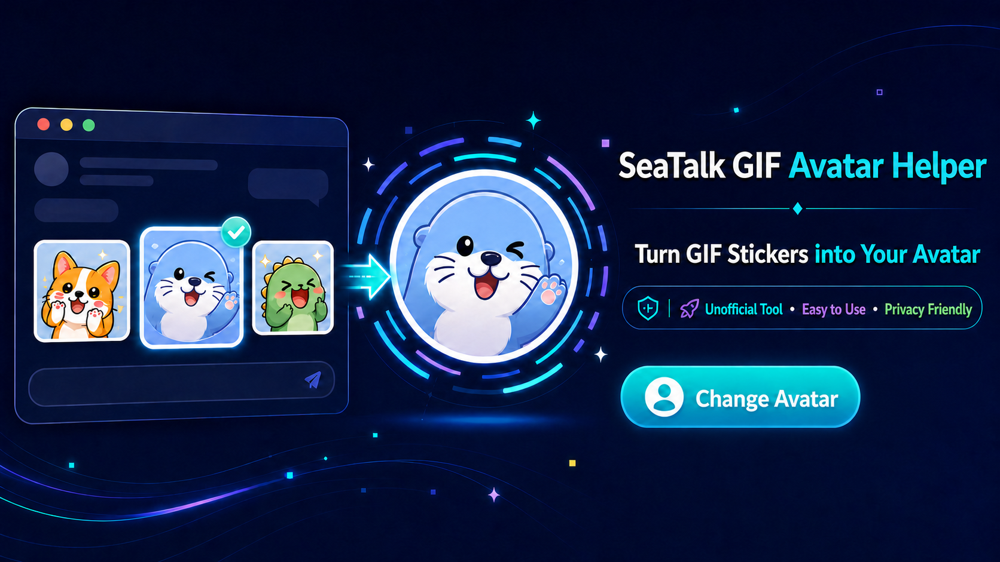
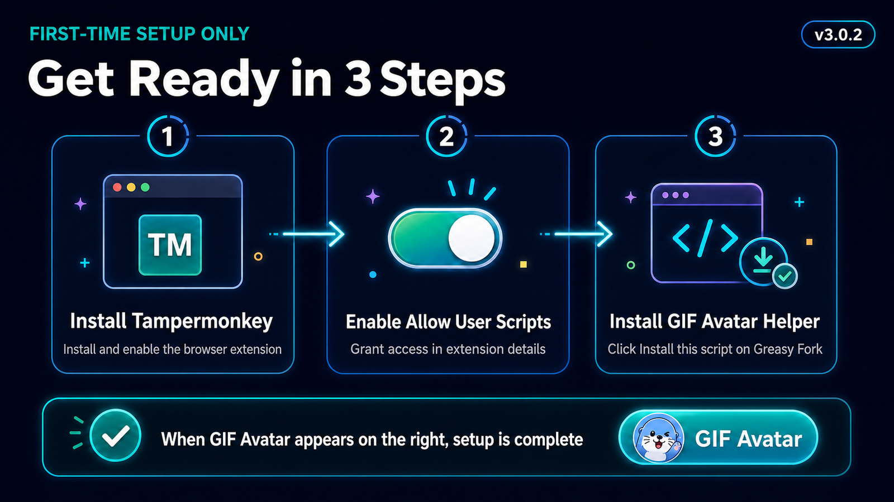
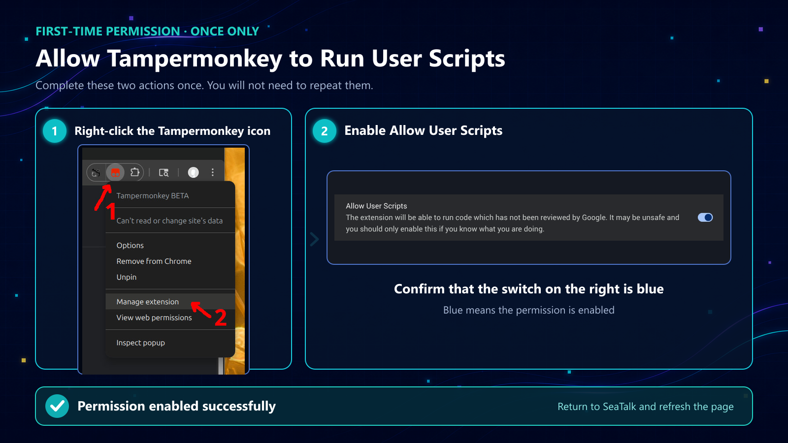

  

  <strong>Use chat GIF stickers as personal or group avatars, and organize and share your favorite stickers in batches.</strong>

  <a href="https://greasyfork.org/en/scripts/588931">Install userscript</a>
  · <a href="https://seatalkweb.com/">Open SeaTalk Web</a>
  · <a href="https://github.com/Candle-Git/seatalk-personal-gif-avatar-helper/issues">Report an issue</a>
  · <a href="README.md">中文</a>

## 5.0.0: Avatar compatibility and batch favorites

- **Personal GIF avatar fix:** Register the sticker resource for avatar use, verify identical file contents, then update your avatar while preserving your name and animation.
- **My favorites:** Search, preview, identify animation, select across pages, review selections, and remove favorites after confirmation.
- **Share codes:** Share 1–100 stickers per code. Recipients paste, preview, select and confirm; existing favorites are skipped.
- **Automatic split view:** On wide screens, SeaTalk stays on the left and the helper opens on the right. Minimize or close to restore the original layout. Smaller screens use a floating window.
- **Consistent windows:** A clear title bar, red close button, minimized entry and always-available guide. Floating windows support dragging and resizing.

This release excludes the sticker market. The avatar helper supports Chinese and English; the new favorites workspace currently uses Chinese labels, translated below.

> **Upgrading from an older or preview version:** The existing installation and update identity is preserved. Disable other beta/preview copies, keep only one helper enabled, then update and reload SeaTalk. Review any Tampermonkey permission prompt; image inspection uses SeaTalk's `f.haiserve.com` image service.

You can also [install the 5.0.0 userscript from GitHub Releases](https://github.com/Candle-Git/seatalk-personal-gif-avatar-helper/releases/download/v5.0.0/SeaTalk-Personal-GIF-Avatar-Helper.user.js). Greasy Fork and GitHub publish independently; check that the installer shows **5.0.0**.

## First-time setup: 3 steps

1. Install and enable the extension from the [Tampermonkey website](https://www.tampermonkey.net/) in Chrome or Edge.
2. **Right-click** the Tampermonkey icon, choose **Manage extension**, and enable **Allow User Scripts**. If unavailable, enable **Developer mode** at `chrome://extensions` or `edge://extensions`.
3. Open the [Greasy Fork script page](https://greasyfork.org/en/scripts/588931), click **Install this script**, and reload [SeaTalk Web](https://seatalkweb.com/).

Open the helper using the **GIF Avatar** button. See the first-time permission guide:

## Change a GIF avatar

1. Open the helper and **Pick a GIF** to preview. Or send a GIF using SeaTalk's **sticker** button, then **Capture GIFs from this chat**. Regular image-file uploads are not supported by this capture entry.
2. Select a GIF under **My avatar** and apply it with the main button.
3. For a group, keep the editable target group's settings open. Under **Group avatar**, check the group name, choose a GIF, then confirm the group and image before applying.

Personal updates use the API result for confirmation; group updates use the avatar observed on the page. Pending requests block repeat submission. Check the result before retrying if the display is still unconfirmed.

## Manage favorites in batches

### Before opening

Open SeaTalk's sticker panel, select the heart **Favorites** tab, then open **我的收藏 (My favorites)** in the helper. Keep the native panel mounted: the helper temporarily hides it while expanded. Do not switch chats or close that native panel during operations; it becomes visible again when the helper is minimized or closed.

### Select and filter

- Click an image to enlarge it. **全选本页 (Select this page)** selects only the current page; selections survive paging and filtering.
- The bottom bar counts all selections. **查看已选 (Review selected)** includes items outside the current filter; sharing and deletion include them too.
- Browsing and sharing need no scan. To filter animations, first choose **识别动图 (Identify animation)**, then **动图 (Animated)**. Failed inspection appears separately as **未能识别 (Could not identify)**.
- The edit button beside a name changes only the name used for this share, not the original SeaTalk favorite.

### Share and add

**Share:** Select 1–100 stickers → **生成分享口令 (Generate share code)** → copy the complete code and send it yourself. More stickers produce longer codes.

**Add:** **导入口令 (Import code)** → paste the complete `STGIF1.` code → **解析并预览 (Parse and preview)** → select available stickers → **确认添加所选表情 (Confirm adding selected stickers)**.

Import rechecks current favorites and skips existing entries. Failed previews cannot be added. Codes contain resource identifiers and the names you entered, without accounts, session credentials or signed image URLs. They are not encrypted; review the names before sharing. The helper sends no messages, and a code cannot guarantee permanent availability or access from every account.

### Remove and verify

Select → **删除所选表情 (Remove selected stickers)** → review images and count → **确认删除 (Confirm removal)**. Only your favorites are removed; chat messages remain. The helper cannot undo removal, and a share code does not guarantee recovery.

If an add or removal result is uncertain, later operations stop. Reload SeaTalk to verify saved favorites before retrying. Stopping waits for the current sticker result before skipping later items. Reloading clears the current selection.

### Split view and floating mode

On wide screens, drag the divider to resize the favorites sidebar. Choose **浮窗 (Floating window)** to drag the entire title bar or resize from the lower-right corner. **−** minimizes while retaining page, filters and selections; click the small entry to restore it. Closing or minimizing restores SeaTalk's original layout without changing browser zoom.

## Status and troubleshooting

Expand **Status and diagnostics** for environment information, stage codes, attempt numbers and elapsed time. **Copy sanitized diagnostics** exports only allowlisted environment fields and flow codes; it excludes accounts, chats, resource IDs, image URLs and raw exceptions. Up to 60 events stay in page memory until reload. Nothing is sent automatically.

`API_SUCCESS` confirms API acceptance. `VISUAL_PENDING` means submission succeeded but the display is unconfirmed. Waiting for visual confirmation does not mean the API failed; do not repeat a pending submission.

- **No button:** Check the extension, script and **Allow User Scripts**, then reload.
- **Avatar or favorites service missing:** Wait for loading, then reload and reopen the appropriate native panel. Include the version, steps and sanitized diagnostics in [GitHub Issues](https://github.com/Candle-Git/seatalk-personal-gif-avatar-helper/issues).
- **Unconfirmed favorites result:** Reload and check before adding or removing again.

## Privacy and compatibility

- The interface runs only on `seatalkweb.com` and its subdomains, using services already available in the current page. Session credentials remain in the page for native service calls.
- Capture, inspection, preview, avatar registration and adding favorites contact SeaTalk's image/business services. There is no separate analytics or tracking service and no upload of chats, passwords or cookies to other services.
- Avatar and favorites changes require user action. Group-avatar and favorites changes include confirmation steps.
- Language and floating-button position use Tampermonkey local storage. Favorite selections, share names and temporary image URLs stay in the page session.
- One personal GIF registration and avatar update was verified in a real SeaTalk 3.71.1 browser session: it survived reload and preserved the name. See the [5.0.0 validation record](docs/RELEASE_5.0.0.md) for separate automated and simulated UI checks. The packaged account workflow, cross-account imports and other SeaTalk versions still need further validation.

Current version: **5.0.0**. This is an unofficial helper, unaffiliated with and not endorsed by SeaTalk. Frontend changes may affect compatibility. See [CHANGELOG.md](CHANGELOG.md) for the full history.

Made by Yixin.Zhong × Codex

