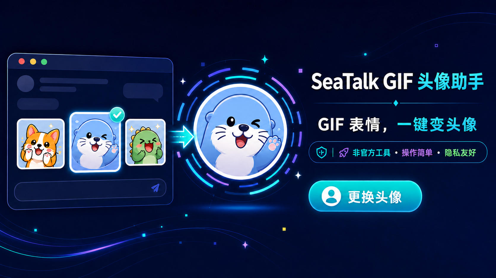
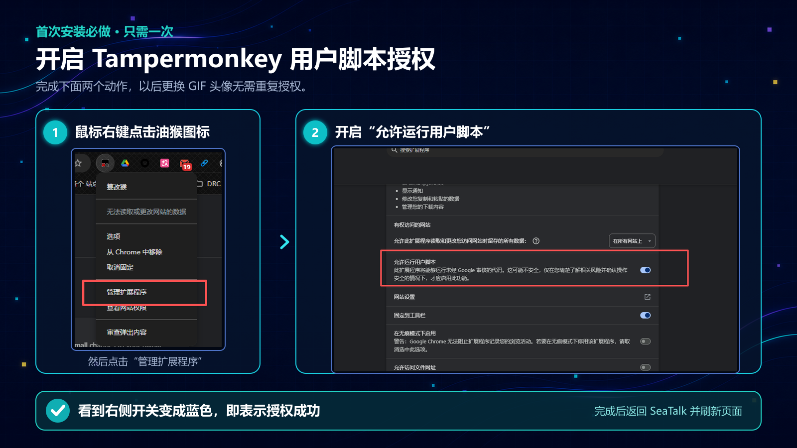

  

  <strong>把聊天里的 GIF 设为个人或群动态头像，也能批量整理、分享你的收藏表情。</strong>

  <a href="https://greasyfork.org/zh-CN/scripts/588931">安装脚本</a>
  · <a href="https://seatalkweb.com/">打开 SeaTalk Web</a>
  · <a href="https://github.com/Candle-Git/seatalk-personal-gif-avatar-helper/issues">反馈问题</a>
  · <a href="README.en.md">English</a>

## 5.0.0：头像适配与收藏批量管理

- **个人 GIF 头像适配**：先将表情资源登记为头像用途，确认文件内容一致，再提交个人头像，保留原昵称与动画。
- **我的收藏**：搜索、预览、识别动图、分页勾选、查看已选及确认后批量删除。
- **分享口令**：每次分享 1–100 个表情；朋友粘贴口令，预览并选择后确认添加，已收藏的自动跳过。
- **自动分栏**：宽屏打开助手时，SeaTalk 在左、助手在右；收起或关闭后恢复原布局。空间不足自动使用浮窗。
- **统一窗口**：清晰的顶栏、红色关闭按钮、可收起入口和常驻「使用指南」。浮窗支持拖动与缩放。

本版不包含表情包市场。头像助手支持中英文；新增的收藏管理界面目前为中文，英文操作说明见 [English guide](README.en.md)。

> **从旧版或预览版升级：** 沿用原脚本安装与更新身份。先停用其他 beta／preview 脚本，确保同一页面只启用一份助手，再更新并刷新 SeaTalk。若 Tampermonkey 提示权限变更，请查看后确认；图片识别需要访问 SeaTalk 图片服务 `f.haiserve.com`。

5.0.0 正式包也可从 [GitHub Releases 直接下载安装](https://github.com/Candle-Git/seatalk-personal-gif-avatar-helper/releases/download/v5.0.0/SeaTalk-Personal-GIF-Avatar-Helper.user.js)。Greasy Fork 与 GitHub 为独立发布入口，安装前请核对显示的版本号为 **5.0.0**。

## 首次安装：只需 3 步

1. 使用 Chrome 或 Edge，从 [Tampermonkey 官方网站](https://www.tampermonkey.net/) 安装并启用扩展。
2. **右键**点击 Tampermonkey 图标，进入 **管理扩展程序**，开启 **允许运行用户脚本**。如没有此选项，在 `chrome://extensions` 或 `edge://extensions` 开启 **开发者模式**。
3. 打开 [Greasy Fork 脚本页面](https://greasyfork.org/zh-CN/scripts/588931)，点击 **安装此脚本**，刷新 [SeaTalk Web](https://seatalkweb.com/)。

页面出现 **GIF头像助手** 按钮即可打开。首次授权可参考下图：

## 更换 GIF 头像

1. 打开助手，点击 **随机挑一个** 预览；或在当前聊天通过 SeaTalk 的 **表情** 按钮发送 GIF，再点击 **从聊天获取**。作为普通图片文件上传的 GIF 不属于此入口。
2. 在 **我的头像** 选择 GIF，再点击主按钮提交。
3. 更换群头像时，先打开目标群设置并保持打开，在 **当前群头像** 核对群名，选择 GIF，再确认群名与图片后提交。

群必须可编辑。个人更新以接口结果确认；群更新以页面观察到目标头像为依据。请求处理中会阻止重复提交，页面显示未确认时请先核对结果。

## 批量管理我的收藏

### 开始前

在 SeaTalk 打开表情面板，切换到爱心 **收藏** 页签，再打开助手的 **我的收藏**。操作期间保持这个原生面板挂载：助手展开时会暂时隐藏它，请勿切换聊天或关闭原生面板；收起或关闭助手后它会恢复显示。

### 选择与筛选

- 点击图片放大，勾选表情；**全选本页** 只选择当前页，翻页或筛选保留之前的选择。
- 底部显示总选择数；**查看已选** 可核对筛选之外的选择，分享和删除都包含这些项目。
- 浏览和分享无需先识别。只看动图时，先点 **识别动图**，再筛选 **动图**；识别失败单独显示为 **未能识别**。
- 点击名称旁的编辑按钮只修改本次分享名称，不改写 SeaTalk 收藏原名称。

### 分享与添加

**分享：** 勾选 1–100 个 → **生成分享口令** → 复制完整口令，自行发给朋友。表情越多，口令越长。

**添加：** **导入口令** → 粘贴完整 `STGIF1.` 口令 → **解析并预览** → 勾选可添加的表情 → **确认添加所选表情**。

导入会再次检查当前收藏，已收藏的自动跳过；预览失败的不可添加。口令包含表情资源标识和你填写的名称，不包含账号、会话凭据或签名图片地址；它不是加密内容，请核对分享名称后再发送。助手不会替你发送消息，口令也不保证资源永久可用或在所有账号可访问。

### 删除与结果核对

勾选 → **删除所选表情** → 核对图片和数量 → **确认删除**。删除只影响自己的收藏，不删除聊天消息；助手无法撤销，分享口令也不保证能恢复。

添加或删除结果不确定时，后续操作会停止。先刷新 SeaTalk 核对保存结果，再决定是否重试。停止操作会等待当前表情结果，再停止后续项目；刷新会清空本次勾选。

### 分栏与浮窗

宽屏默认分栏；收藏侧栏左边的分隔线可拖动调整宽度。切换 **浮窗** 后，拖动整条顶栏移动，拖动右下角调整大小。顶栏 **−** 收起并保留页码、筛选和选择，点击小入口恢复；关闭或收起后恢复 SeaTalk 原布局，不改变浏览器缩放。

## 运行状态与问题反馈

展开 **运行状态与调试信息** 可查看环境、阶段码、操作编号和耗时。**复制脱敏诊断** 只导出允许的环境字段与流程码，不包含账号、聊天、资源 ID、图片地址或原始异常；最多保存本页会话的 60 条记录，刷新清空，不自动发送。

`API_SUCCESS` 表示接口成功；`VISUAL_PENDING` 表示提交成功但页面显示尚未确认。等待页面验证不等于接口失败，处理期间不要重复提交。

- **没有按钮：** 检查扩展、脚本和「允许运行用户脚本」，刷新页面。
- **找不到头像入口／收藏服务：** 等待页面加载，再刷新并重开相应原生面板；通过 [GitHub Issues](https://github.com/Candle-Git/seatalk-personal-gif-avatar-helper/issues) 反馈版本、复现步骤和脱敏诊断。
- **收藏结果未确认：** 先刷新核对，勿立即重复添加或删除。

## 隐私与兼容性

- 界面仅在 `seatalkweb.com` 及其子域页面运行，使用当前页面已有的 SeaTalk 服务；会话凭据仅在页面内供原生服务使用。
- 抓取、识别、预览、头像登记和收藏添加会访问 SeaTalk 的图片／业务服务；没有独立统计或追踪服务，不向其他服务上传聊天、密码或 Cookie。
- 头像更新、收藏添加和删除均由用户主动操作；群头像和收藏变更有确认步骤。
- 语言和浮动按钮位置保存在 Tampermonkey 本地；收藏选择、分享名称和临时图片地址只在页面会话内保留。
- 真实浏览器中已验证 SeaTalk 3.71.1 的单个 GIF 个人头像登记及更新，刷新后保留、昵称未变；自动化与模拟界面检查另见 [5.0.0 验证记录](docs/RELEASE_5.0.0.md)。正式安装包的完整账号流程、跨账号导入和其他 SeaTalk 版本仍需继续验证。

当前版本：**5.0.0**。本项目为非官方辅助工具，与 SeaTalk 官方无隶属、合作或认可关系。前端变化可能影响兼容性。完整历史见 [CHANGELOG.md](CHANGELOG.md)。

Yixin.Zhong × Codex 制作

