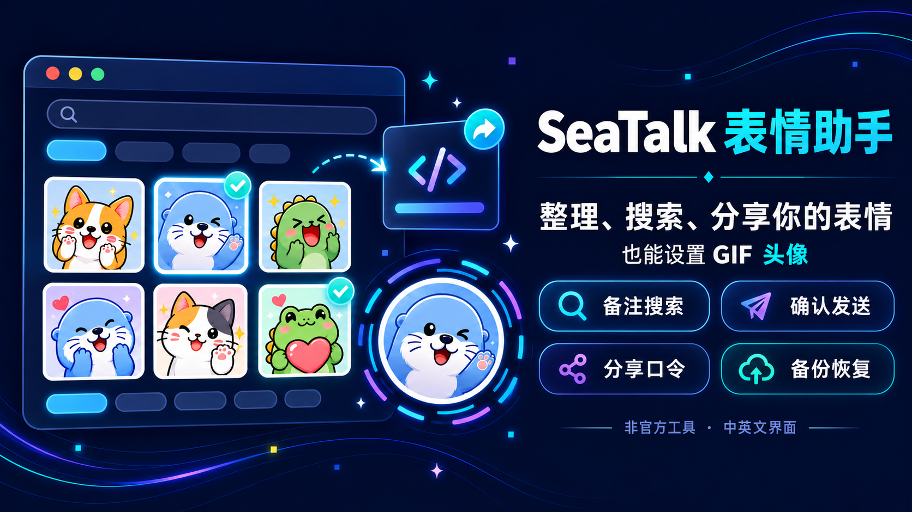
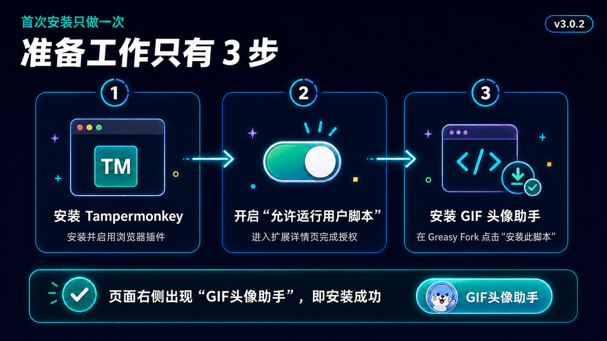

# SeaTalk 表情助手 · 5.2.0

> **从 GIF 头像工具，升级为 SeaTalk 表情助手 / SeaTalk Sticker Helper。**
>
> 整理、搜索、分享你的 SeaTalk 收藏表情，也能设置 GIF 头像。

## 安装与升级

1. 安装 [Tampermonkey](https://www.tampermonkey.net/)，开启「允许运行用户脚本」。
2. 在 [Greasy Fork 原脚本页面](https://greasyfork.org/zh-CN/scripts/588931) 安装或更新，核对版本 **5.2.0**。
3. 停用其他预览脚本，刷新 [SeaTalk Web](https://seatalkweb.com/)，点击「SeaTalk 表情助手」。

沿用原脚本安装名称与更新身份，现有备注保留。安装列表可能仍显示旧名，界面已统一为新名。

## 这次升级带来什么？

- **找得到**：备注名称、关键词、表情文字和私人说明均可搜索。
- **发得顺手**：从单张预览或多选入口发送，先核对当前单聊／群聊、图片与数量，再确认逐条发送。
- **分享更完整**：分享口令可携带名称、关键词和表情文字；已有备注默认保留，关键词合并去重。
- **个人设置可迁移**：导出备注与手动图片形式标注，换电脑时预览导入恢复。需复核的 AI 标签默认不选，也可手动全选。
- **分类更清楚**：图片形式、备注状态、检测状态独立筛选；未检测或检测失败仍可备注，动图／静态图可手动纠正。
- **界面一致**：两个模块共用中文／EN 设置；侧栏、浮窗和最小化名称统一。

**GIF 头像继续保留**：个人与群 GIF 头像仍在「GIF 头像」模块。宽屏自动分栏，支持收起、关闭及浮窗拖动与缩放。

## 我的表情：从整理到发送

1. 在 SeaTalk 打开表情面板的爱心「收藏」页签，再进入助手 **我的表情**。保持原生收藏面板挂载。
2. 点击名称旁的编辑按钮设置备注、关键词、表情文字、私人说明，以及自动／手动图片形式。保存备注会解除需复核标记。
3. 用搜索和三组筛选定位；翻页保留勾选，「查看已选」可核对所有选择。
4. 预览图片后选「发送到当前会话」，或勾选后选「发送所选表情」。确认框内核对目标会话和图片，再确认发送。每次最多 100 张，仅支持普通单聊／群聊，暂不支持话题窗口。

切换账号或会话会停止后续发送。结果未确认时不会自动重发，请核对聊天记录后刷新。发送功能需要你逐次确认。

## 分享与导入

选择 1–100 个表情 → **生成分享口令** → 自行复制发给朋友。朋友通过 **导入口令 → 解析并预览 → 选择 → 确认添加** 操作。已收藏的不会重复添加，也可只导入其备注；新表情必须成功预览。

含备注的 `STGIF2` 口令需要 5.2 或兼容预览版本；取消附带备注可生成旧版 `STGIF1` 口令。私人说明和手动图片形式不放入分享口令。口令包含资源标识和可选备注，是可读内容，不保证资源永久可用。

## 备份与恢复

**设置 → 导出个人备份**，保存 JSON 文件。换电脑后 **选择备份或标签文件 → 查看预览 → 选择 → 确认导入备注**。已有备注默认保留，可逐条选择使用导入备注；关键词默认合并。

备份包含私人说明，请自行保管。备注按账号保存在油猴本地存储；清理扩展存储或卸载脚本可能丢失，请提前备份。导入备份只恢复备注与图片形式设置，不会添加、删除或发送表情，也不是图片文件备份。

## GIF 头像

通过随机示例或「从聊天获取」预览 GIF，再确认更新个人头像。群头像须打开可编辑群设置，核对群名和图片后确认。请求处理中会阻止重复提交，结果未确认时先核对页面。

## 隐私与兼容性

脚本仅在 SeaTalk Web 运行，使用 SeaTalk 自身的图片与业务服务；没有独立追踪服务，不向其他服务上传聊天、密码或 Cookie。新增发送只在你确认后调用 SeaTalk 原生流程。结果不确定即停止，不自动重试。

真实账号兼容范围与历史检查记录见 [5.2.0 发布记录](docs/RELEASE_5.2.0.md)。本工具为非官方工具，与 SeaTalk 官方无隶属、合作或认可关系。

[GitHub Release · 5.2.0](https://github.com/Candle-Git/seatalk-personal-gif-avatar-helper/releases/tag/v5.2.0) · [Issues](https://github.com/Candle-Git/seatalk-personal-gif-avatar-helper/issues) · [English](README.en.md)
