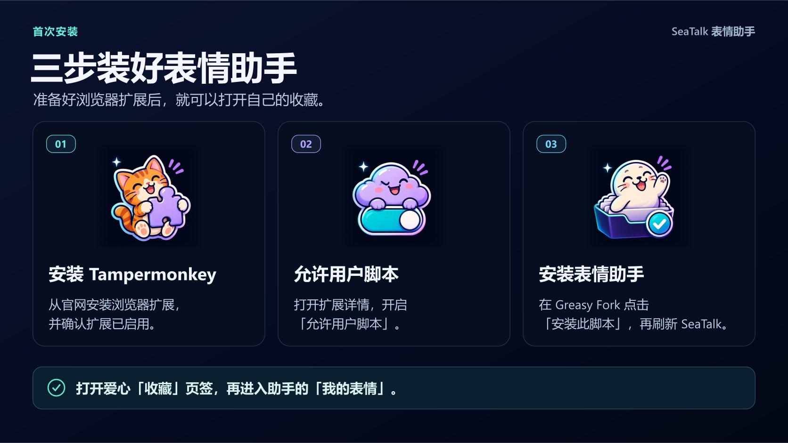
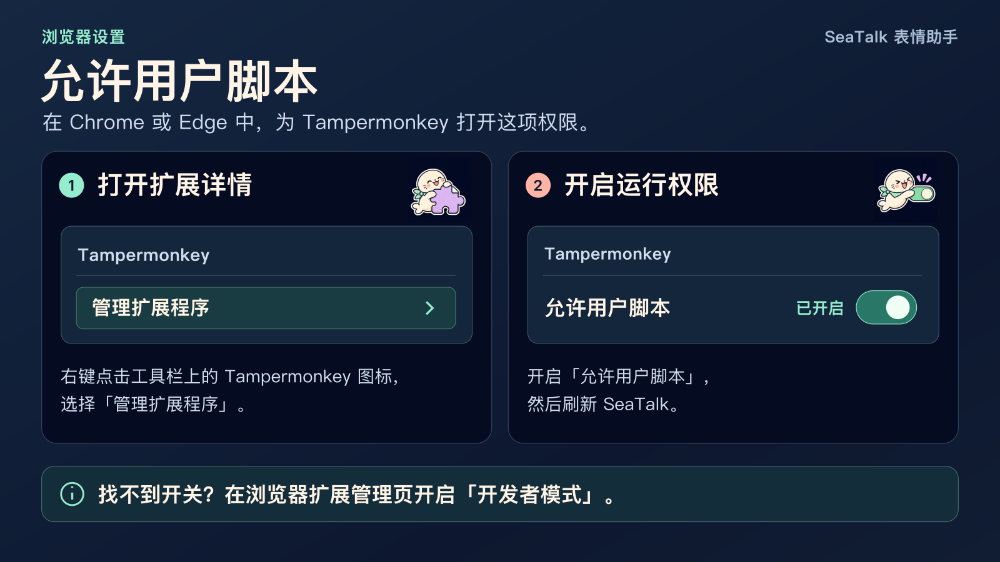

**简体中文** | [English](README.en.md)

# SeaTalk 表情助手 · v5.3.0

- **想回一句「大笑」？** 点聊天输入框旁戴薄荷绿围巾的小海豹，搜「大笑」。快选默认打开「全部」，按名称和关键字查找。也可以点「未分组」或自己的分组，只看这组的结果。核对顶部的会话名，点一张就发出。
- **想收下群里刚发的几张表情？** 点「从聊天收藏」，拖过几条消息，预览后选同一个分组，再确认收藏。纯文字会跳过，重复的表情只算一张。

## 安装并找到入口

1. 安装 [Tampermonkey](https://www.tampermonkey.net/)，在 Chrome 或 Edge 的扩展详情中开启「允许用户脚本」。若没有这个开关，可开启扩展管理页的「开发者模式」。
2. 安装或原地更新 [SeaTalk 表情助手 · v5.3.0](https://greasyfork.org/zh-CN/scripts/588931)。从 5.2 升级且手头有旧备份要恢复，请先看[升级说明](#从-52-升级)。
3. 刷新 [SeaTalk Web](https://seatalkweb.com/) 并打开单聊或群聊。在输入框工具栏找「表情快选」。若提示收藏尚未载入，先打开一次 SeaTalk 自带表情面板里的爱心「收藏」，再打开快选。

查看安装图解与浏览器权限开关

## 整理、发送和分享

在「表情快选」点 **管理表情**。管理页默认打开「未分组」，搜索只查当前组。点最左侧固定的「全部」即可跨组搜索。

| 想做什么 | 怎么操作 |
| --- | --- |
| 给一批表情改名、分组 | 按住 Ctrl／⌘ 逐张点选，按 Shift 连选，或从空白处拖动框选。点「批量整理」，可以统一改名、移组或追加关键字。留空保留原值，覆盖名称前会显示影响张数。单张可用「编辑表情」。 |
| 把多张发给同一个人或群 | 在管理页点卡片只会选中。选好后点「发送」，核对会话、图片和数量，再确认。每次最多 100 张。 |
| 把一组分享给朋友 | 选 1–100 张，点「生成分享口令」。默认附带名称和搜索关键字，可取消。对方在「工具 → 导入口令」预览并确认。已收藏的表情会跳过重复添加，同一张表情默认保留对方已有的名称，关键字合并去重。 |
| 换电脑，带走自己的设置 | 在「设置 → 个人数据」导出 JSON，在另一台电脑登录同一账号，选择文件，预览后确认导入。备份保存名称、关键字、分组、手动图片形式和复核状态。图片仍由 SeaTalk 提供。 |

按动图或静态图筛选、同步收藏和移除收藏的操作，可在管理页顶栏的「使用指南」查看。个人设置按账号保存在当前浏览器的 Tampermonkey 中。

## 从 5.2 升级

原地更新会保留本机设置。需要恢复旧个人备份时，先在 5.2 中导入，再升级。5.3 只读取 `STGIF3` 口令和第 3 版个人备份（`schema: 3`）。以前的 `STGIF1`、`STGIF2` 口令请在升级后重新生成，换机前请重新导出备份。

旧的「表情文字」和「私人说明」仍可在原浏览器搜索。新备份和分享口令均省略这两项，需要存档时请保留原来的 5.2 备份。

[5.3.0 发布说明](docs/release-notes-5.3.0.md) · [反馈问题](https://github.com/Candle-Git/seatalk-personal-gif-avatar-helper/issues)
