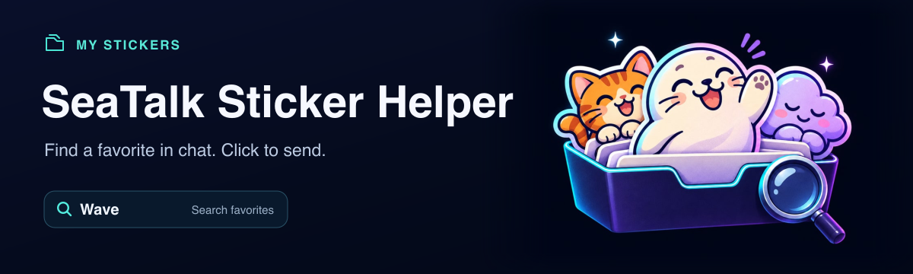
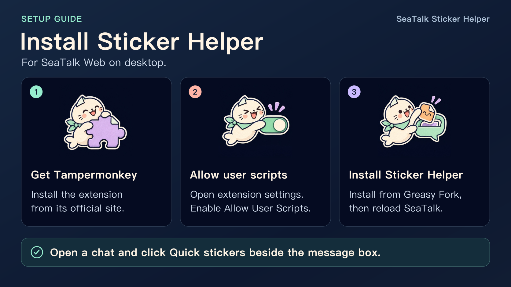
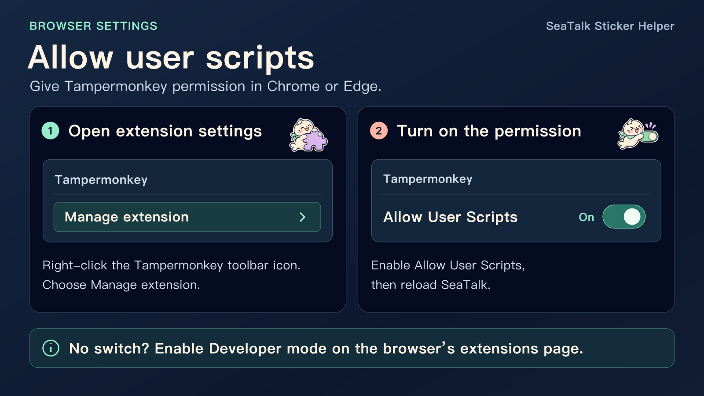

[简体中文](https://greasyfork.org/zh-CN/scripts/588931) | **English**

# SeaTalk Sticker Helper · v5.3.1

Looking for a laughing sticker? Open **Quick stickers** beside the chat input and search names and keywords for “laugh.” The picker opens on **All**. Choose **Ungrouped** or one of your groups to search within it. Check the chat name at the top, then click a sticker to send it.

Found a few you like in a group chat? Choose **Collect from chat**, then drag across the messages. The chat toolbar shows how many stickers you selected. Choose **Preview** to review them, optionally pick a group or add keywords, then confirm.

## Where to find it after installing

1. Install [Tampermonkey](https://www.tampermonkey.net/) and enable **Allow User Scripts** in its Chrome or Edge extension settings. If the switch is unavailable, enable **Developer mode** on the extensions page.
2. Click **Install this script** at the top of this page and confirm in Tampermonkey. To restore a 5.2 backup, import it in 5.2 before upgrading.
3. Reload [SeaTalk Web](https://seatalkweb.com/) and open a direct or group chat. Click the seal wearing a mint-green scarf in the chat toolbar to open **Quick stickers**. If favorites haven’t loaded, open the heart-shaped **Favorites** tab in SeaTalk’s own sticker picker once.

## Choose Manage stickers in the picker

- **Organize a batch.** Ctrl-click or ⌘-click individual stickers, Shift-click a range, or drag from empty space to select several. Rename them together, move them to a group or append keywords. The manager searches the current group. Choose **All** on the left to search every group.
- **Send or share.** Clicking cards in the manager selects them. Check the recipient and images before sending a batch, or share a code that a friend can preview and import. Each batch or code holds up to 100 stickers. Codes can include names and keywords. Your friend’s existing names are kept by default.
- **Back up your settings.** Export or restore names, keywords, groups, manual image formats and review status under **Settings → Personal data**. Settings are stored for each account in this browser’s Tampermonkey storage.

**Upgrading from 5.2.** Updating in place keeps your local settings. Generate fresh share codes and export a new personal backup after updating. Version 5.3 reads only `STGIF3` codes and version 3 personal backups. Previously saved sticker text and private notes remain searchable in the original browser. New codes and backups omit these fields. Keep the 5.2 backup if you need an archive.

## Illustrated installation guide

[Full user guide](https://github.com/Candle-Git/seatalk-personal-gif-avatar-helper/blob/main/README.en.md) · [5.3.1 release notes](https://github.com/Candle-Git/seatalk-personal-gif-avatar-helper/blob/main/docs/release-notes-5.3.1.md)
