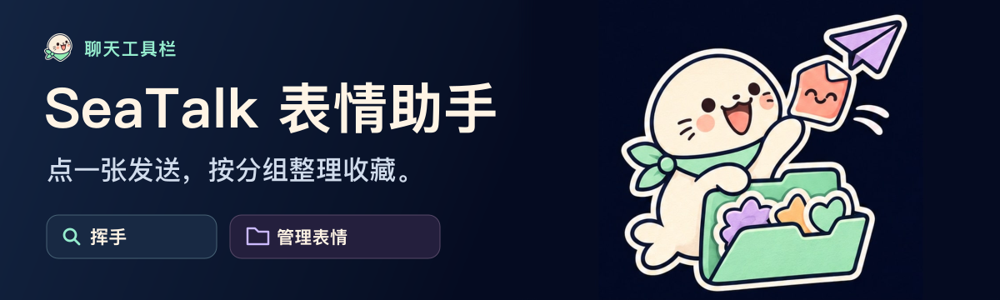
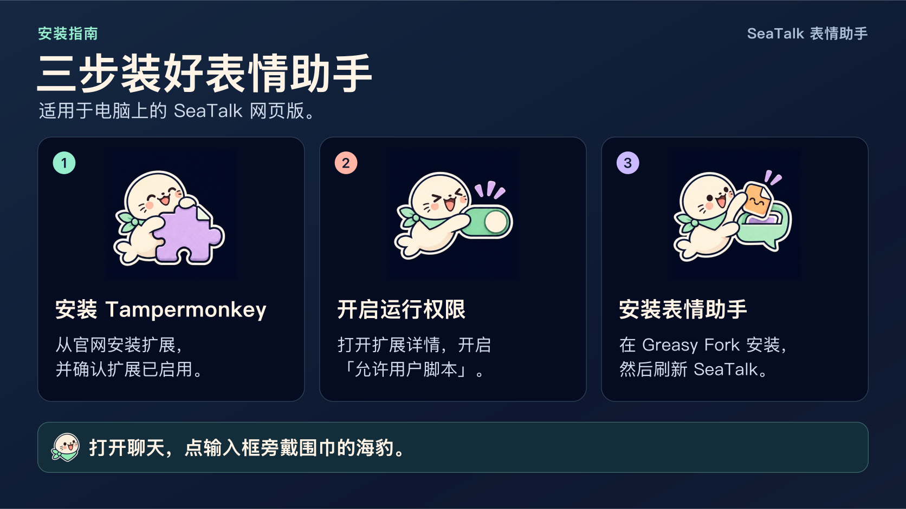
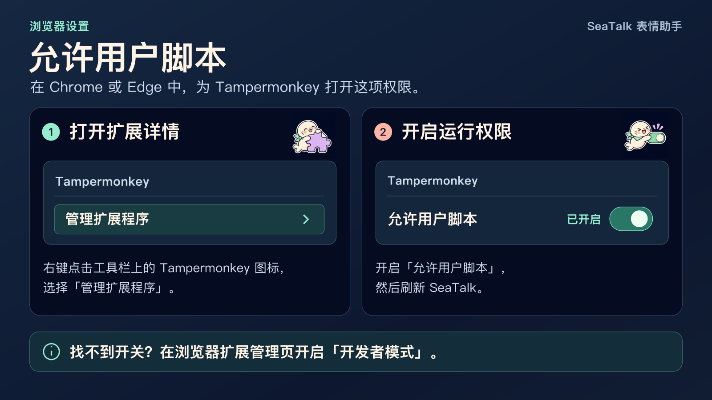

**简体中文** | [English](https://greasyfork.org/en/scripts/588931)

# SeaTalk 表情助手 · v5.3.0

想回一张「大笑」？打开输入框旁的 **表情快选**，按名称或关键字搜索全部收藏。核对面板顶部的会话名，点一张就发出。

群里刚发了几张想留的表情？点 **从聊天收藏**，拖过消息，预览后选一个分组，再确认收藏。纯文字会跳过，重复的表情只收一次。

## 安装后去哪里找

1. 安装 [Tampermonkey](https://www.tampermonkey.net/)，在 Chrome 或 Edge 的扩展详情页开启「允许用户脚本」。如果没有此项，可在扩展管理页开启「开发者模式」。
2. 点本页上方 **安装此脚本**，在 Tampermonkey 中确认。若要恢复 5.2 的旧备份，请先在 5.2 中导入，再升级。
3. 刷新 [SeaTalk Web](https://seatalkweb.com/) 并打开单聊或群聊。点聊天工具栏里戴薄荷绿围巾的小海豹，打开「表情快选」。若收藏尚未载入，先打开一次 SeaTalk 自带表情面板的爱心「收藏」。

## 在快选中点「管理表情」

- **整理一批**。按住 Ctrl／⌘ 逐张点选，用 Shift 连选，或从空白处拖动框选。可一起改名、移组或追加关键字。管理页搜索当前组，最左侧的「全部」可跨组搜索。
- **发送或分享**。在管理页点卡片只会选中。可核对接收人和图片后批量发送，或生成口令让朋友预览后添加。每次最多 100 张。分享可附带名称和关键字，同一张表情默认保留对方已有的名称。
- **备份设置**。在「设置 → 个人数据」导出或恢复名称、关键字、分组、手动图片形式和复核状态。个人设置按账号保存在当前浏览器的 Tampermonkey 中。

**从 5.2 升级**。原地更新保留本机设置。升级后请重新生成分享口令、重新导出个人备份。5.3 只读取 `STGIF3` 和第 3 版个人备份。旧的「表情文字」和「私人说明」仍可在原浏览器搜索，新的分享和备份均省略这两项。需要存档时请保留 5.2 原备份。

## 安装图解

[完整使用说明](https://github.com/Candle-Git/seatalk-personal-gif-avatar-helper/blob/main/README.md) · [5.3.0 发布说明](https://github.com/Candle-Git/seatalk-personal-gif-avatar-helper/blob/main/docs/release-notes-5.3.0.md)
